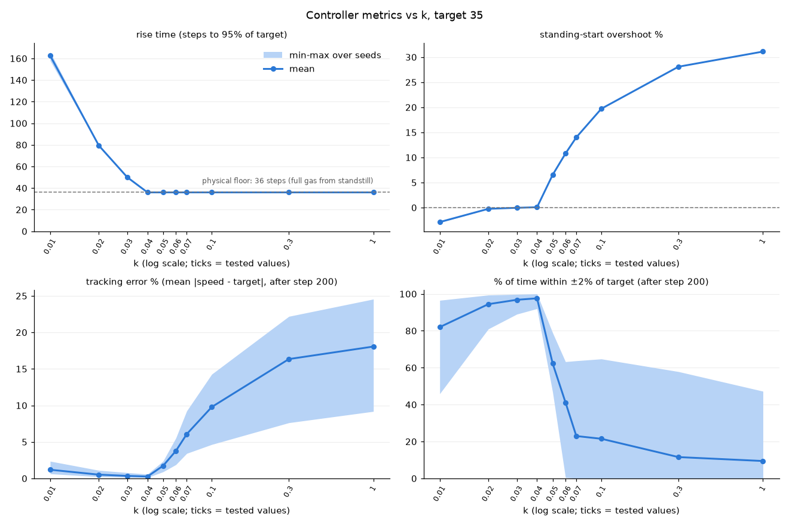

# rl-car-racing

Learning imitation learning on Gymnasium's `CarRacing-v3`: record human demonstrations,
train behavioral cloning policies (MSE CNN, then Gaussian, mixture of Gaussians,
discretized/autoregressive, and flow-matching heads), and study compounding errors with HG-DAgger.

## Setup

```bash
python3 -m venv .venv
source .venv/bin/activate
pip install swig            # needed first: Box2D builds against it
pip install -r requirements.txt
```

## Run

Drive the car yourself with the built-in demo (arrow keys to steer/gas/brake):

```bash
python -m gymnasium.envs.box2d.car_racing
```

Test-drive with steering only (left/right arrows; the speed controller handles gas):

```bash
python -m il.speed_control --target-speed 35
```

Run the tests:

```bash
python -m pytest tests/
```

## Speed controller (steering-only actions)

To study multimodal demonstrations (passing an obstacle on the left vs the right), the action is
reduced to steering alone. `il/speed_control.py` is a Gymnasium wrapper that works on both
`CarRacing-v3` and `CarRacingObstacles-v0` featuring a proportional controller that automatically sets the gas every step, reducing our policy dimensionality just to 1 (steering).

```
gas = clip(k * (target_speed - speed), 0, 1),   brake = 0
```

- **Defaults:** `target_speed = 35`, chosen by test-driving as the fastest speed that still handles
  hairpins and obstacles. `k = 0.04`, chosen from the sweep below.


### Choosing k

`il/tune_speed_control.py` sweeps 10 values of k over 5 seeds at target 35. Each run is a full
1000-step episode with the same centerline-following steering rule.



- **Larger k only adds overshoot.** It keeps the gas floored longer, and the stored wheelspin keeps
  pushing after the gas is cut. With no drag or brake, the extra speed persists until turns bleed
  it off: +6.6% at k = 0.05, +20% at 0.1, and +31% at 1.
- **k = 0.04 is the edge.** It matches the fastest rise, overshoots by almost 0%, and spends 98% of
  the time within ±2% of target after settling, the best of every k tested. Smaller k never overshoots but rises more slowly (50–160 steps).

To reproduce:

```bash
python -m il.tune_speed_control sweep               # ~8 min; logs every step to runs/tune_speed_control/
python -m il.tune_speed_control plot                # redraws metrics.csv and plots/ from the logs
python -m il.tune_speed_control replay --k 0.1 --seed 3   # MP4 in videos/; --render-mode human for a window
```

Full measurements and reasoning are in `notes/log.md` (2026-10-15 and 2026-10-16).

## Layout

- `il/` — project code (`obstacles.py`, `speed_control.py`, `tune_speed_control.py`)
- `tests/` — pytest tests
- `docs/` — figures used in this README
- `notes/log.md` — lab notebook
- `data/`, `runs/`, `videos/` — demonstrations, training runs, recordings (git-ignored)
